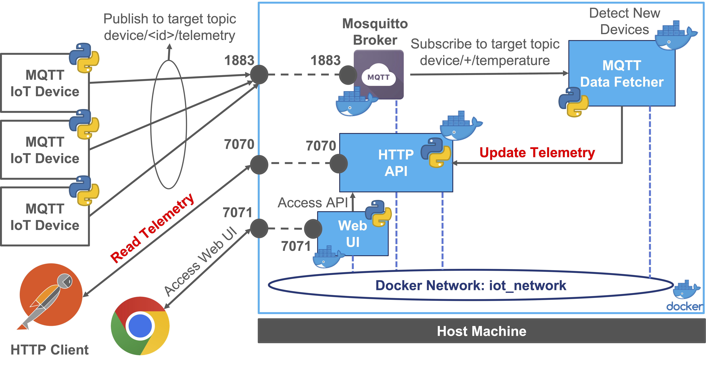
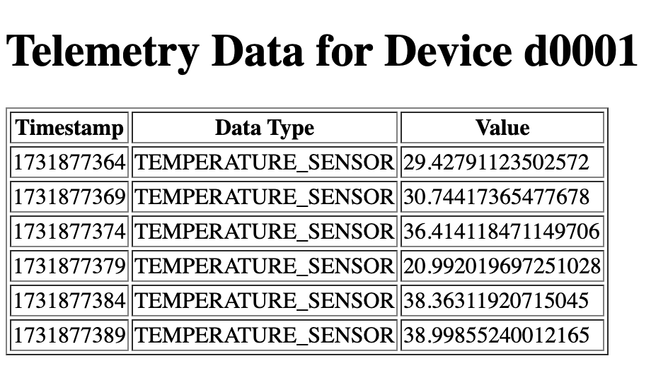
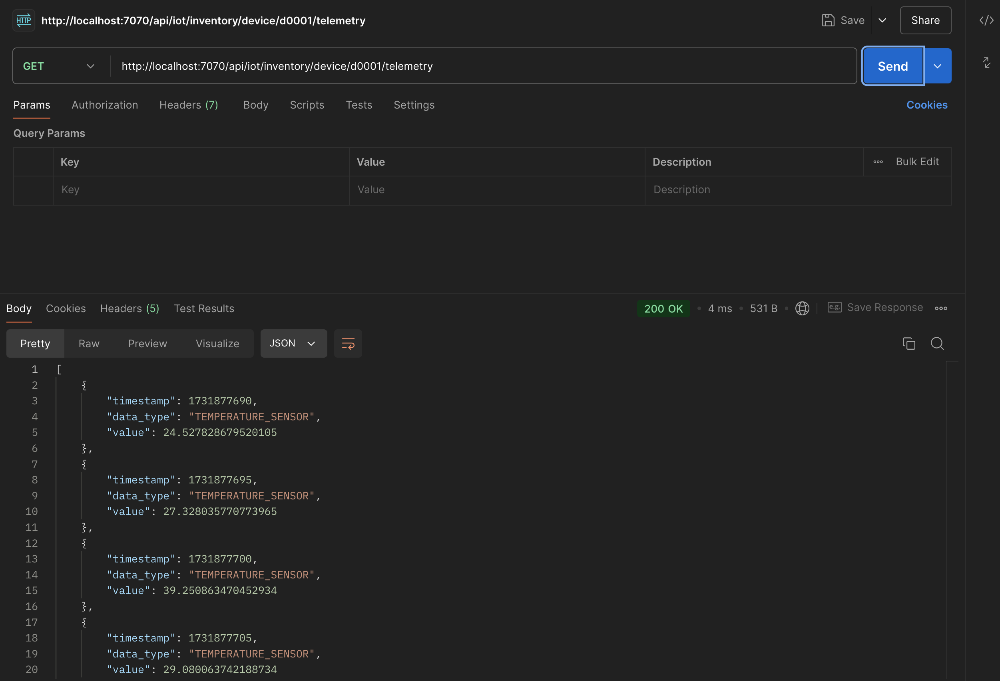

# Microservices IoT Application with Docker - Laboratory

This project is designed as an IoT Microservices Software Architecture Laboratory with the step by step
implementation of a simple IoT application using microservices and containers.
The application is structured into different modules,
each responsible for specific functionalities, ensuring modularity, scalability, and maintainability.

The architecture is divided into 4 distinct containers,
each responsible for specific functionalities, ensuring modularity,
scalability, and maintainability.

>This Laboratory is a "simplified" version of the IoT Microservices Architecture Playground
>([https://github.com/Distributed-IoT-Software-Arch-Course/iot-microservice-arch-playground](https://github.com/Distributed-IoT-Software-Arch-Course/iot-microservice-arch-playground))
>and a "porting" to microservices of the IoT Monolithic Architecture Laboratory
>([https://github.com/Distributed-IoT-Software-Arch-Course/iot-monolithic-arch-laboratory](https://github.com/Distributed-IoT-Software-Arch-Course/iot-monolithic-arch-laboratory)).
>For this reason the explanation of the source code focuses on the differences with respect to the monolithic
>application and on the new elements related to Docker, to the Microservices Architecture and to the communication
>between the components.



The main components of the system are:

- **MQTT Broker**: The MQTT broker is used to receive telemetry data from IoT devices and publish them to the subscribers.
- **IoT Inventory**: The HTTP API is used to manage device telemetry data and interact with the MQTT Data Fetcher.
- **MQTT Data Fetcher**: MQTT to HTTP Inventory Integration: The MQTT Data Fetcher is used to subscribe to an MQTT topic and process incoming messages to interact with the Inventory API.
- **Web UI**: The Web Interface is used to interact with the inventory system and display the device telemetry data.

The outline of the laboratory is the following:

- [Project Structure \& uv](#project-structure--uv)
- [Create a Docker Network](#create-a-docker-network)
- [MQTT Broker - Eclipse Mosquitto](#mqtt-broker---eclipse-mosquitto)
- [Python - IoT Inventory - RESTful HTTP API](#python---iot-inventory---restful-http-api)
- [MQTT Data Fetcher - MQTT to HTTP Inventory Integration](#mqtt-data-fetcher---mqtt-to-http-inventory-integration)
- [Web UI - IoT Inventory Web Interface](#web-ui---iot-inventory-web-interface)
- [MQTT Temperature Sensor Example](#mqtt-temperature-sensor-example)
- [Run \& Test the System](#run--test-the-system)
- [Docker Compose](#docker-compose)

## Project Structure & uv

Each microservice is an **independent Python project**, with its own dependencies, configuration and Dockerfile:
it can be developed, tested, built and deployed without the others.

```
iot-microservice-arch-laboratory/
├── mqtt-broker/            # Configuration of the Eclipse Mosquitto broker
├── http-api/               # IoT Inventory RESTful HTTP API (telemetry data)
├── data-fetcher/           # MQTT Data Fetcher (MQTT to HTTP integration)
├── web-ui/                 # Web Interface
├── mqtt-tester/            # Emulated IoT devices (not deployed with Docker)
└── docker-compose/         # Docker Compose file and the configuration files of the deployment
```

Every Python project is managed with [uv](https://docs.astral.sh/uv/): dependencies are declared in its
`pyproject.toml`, locked in its `uv.lock`, and the Python version (3.12) is pinned in its `.python-version`.
Install uv (if needed) following the [official instructions](https://docs.astral.sh/uv/getting-started/installation/), e.g.:

```bash
curl -LsSf https://astral.sh/uv/install.sh | sh
```

Each project follows the `src` layout (the code is in the `src/<package_name>` folder) and has the following files:

- `pyproject.toml`: metadata, dependencies and the command that starts the service (`[project.scripts]`);
- `uv.lock`: the locked versions of all the dependencies, created and updated by uv (`uv lock`);
- `.python-version`: the Python version used by the project (`3.12`);
- a default configuration file for the local development (e.g., `conf.yaml`) and, for the services that need it,
  a `target_*` configuration file for the Docker deployment;
- `Dockerfile` and `.dockerignore`: the build of the container image;
- `requirements.txt`: **generated** from `uv.lock` (`uv export --no-hashes --no-dev -o requirements.txt`) and kept
  only for pip-based workflows.

A new project with this structure can be created with `uv init --package <project_name>`, while a dependency is
added with `uv add <package>`. To run a service locally, move to its folder, install the dependencies and run its command:

```bash
cd http-api
uv sync
uv run iot-inventory-api
```

All the services read their configuration file through the same `ConfigLoader` class (in the `config` package of each
service), that searches the file in the current working directory and then in the root folder of the service, and
merges its values over the default configuration of the service:

```python
from pathlib import Path
from typing import Any

import yaml


class ConfigLoader:
    """
    ConfigLoader class loads the YAML configuration file of the service (e.g., conf.yaml).

    A relative path is searched in the current working directory and, if not found, in the service root directory,
    so the service can be started from any folder.
    """

    # Service root directory: src/iot_inventory_api/config/config_loader.py -> 3 levels up
    PROJECT_ROOT_DIR = Path(__file__).resolve().parents[3]

    @classmethod
    def resolve_path(cls, config_file: str | Path) -> Path:
        """
        Resolve the path of a configuration file
        :param config_file: Absolute path or path relative to the working directory or to the project root
        :return: The path of the existing configuration file
        """

        config_path = Path(config_file)
        if config_path.is_absolute():
            candidate_paths = [config_path]
        else:
            candidate_paths = [Path.cwd() / config_path, cls.PROJECT_ROOT_DIR / config_path]

        for candidate_path in candidate_paths:
            if candidate_path.is_file():
                return candidate_path

        raise FileNotFoundError(f"Configuration file not found. Searched in: {[str(p) for p in candidate_paths]}")

    @classmethod
    def load(cls, config_file: str | Path, default_configuration: dict[str, Any] | None = None) -> dict[str, Any]:
        """
        Load a YAML configuration file, merging its values over the default configuration
        :param config_file: Path of the YAML file (see resolve_path)
        :param default_configuration: Default values used for the parameters not defined in the file
        :return: The configuration dictionary
        """

        configuration: dict[str, Any] = dict(default_configuration or {})

        config_path = cls.resolve_path(config_file)
        with open(config_path, "r", encoding="utf-8") as file:
            file_configuration = yaml.safe_load(file) or {}

        # Merge the file values over the defaults (one level of nested sections, e.g., "rest" or "web")
        for key, value in file_configuration.items():
            if isinstance(value, dict) and isinstance(configuration.get(key), dict):
                configuration[key] = {**configuration[key], **value}
            else:
                configuration[key] = value

        print(f"Read Configuration from file ({config_path}): {configuration}")
        return configuration
```

## Create a Docker Network

Since we are going to deploy multiple containers, we need to create a dedicated network to allow communication between them.
**In this way containers can communicate with each other using the container name as the hostname.**
This approach will simplify the configuration and the deployment of the services instead of using the IP address of the host machine.

Create a Docker network to allow the containers to communicate with each other:

```bash
docker network create iot_network
```

Listing the networks:

```bash
docker network ls
```

All the containers that we are going to build and deploy will be connected to this network to allow communication between them.
In order to connect a container to a network, you can use the following parameter `--network iot_network` at the run time:

```bash
docker run --name=<container_name> --network iot_network <other_options> <image_name>
```

## MQTT Broker - Eclipse Mosquitto

This section provides a guide for setting up and customizing an MQTT broker using Eclipse Mosquitto.
We use the official eclipse-mosquitto Docker image on Docker Hub ([Link](https://hub.docker.com/_/eclipse-mosquitto)),
and the version for this example is `2.0.22`.

We "customize" our MQTT broker at runtime with the following configurations:

- Local `mosquitto.conf` file: `-v <LOCAL_PATH>/mosquitto.conf:/mosquitto/config/mosquitto.conf`
- Local `data` folder for persistence: `-v <LOCAL_PATH>/data:/mosquitto/data`
- Local `log` folder for easy access: `-v <LOCAL_PATH>/log:/mosquitto/log`
- Port mapping: `-p 1883:1883`
- Restart always: `--restart always`
- Daemon mode: `-d`

Move to the broker folder

```bash
cd mqtt-broker
```

Run the container (on Linux and macOS, and in Windows PowerShell, `${PWD}` is the current folder):

```bash
docker run --name=my-mosquitto-broker --network iot_network -p 1883:1883 -v ${PWD}/mosquitto.conf:/mosquitto/config/mosquitto.conf -v ${PWD}/data:/mosquitto/data -v ${PWD}/log:/mosquitto/log --restart always -d eclipse-mosquitto:2.0.22
```

At the end of the test, you can stop and remove the container using the following commands:

```bash
docker stop my-mosquitto-broker
docker rm my-mosquitto-broker
```

## Python - IoT Inventory - RESTful HTTP API

In this example we have a demo implementation of a simple IoT device telemetry inventory through an HTTP RESTful API.
It utilizes Flask and Flask RESTful and provides a simple API to manage telemetry JSON messages that is going to be
used by the other components of the system such as the MQTT Data Fetcher and the Web Interface together with
external clients through HTTP requests.

The API exposes a single resource with the prefix `/api/v1/iot/inventory`:

| Resource                        | Method | Description                                                       |
|---------------------------------|--------|-------------------------------------------------------------------|
| `/device/<device_id>/telemetry` | GET    | Read the telemetry data of the device (`404` if it has no data)  |
| `/device/<device_id>/telemetry` | POST   | Add a new telemetry data to the device (`201 Created`)           |

Create the folder `http-api` for the project. The code is in the package `src/iot_inventory_api` with the
following structure:

```
http-api/
├── pyproject.toml
├── uv.lock
├── .python-version
├── conf.yaml
├── Dockerfile
├── .dockerignore
└── src/iot_inventory_api/
    ├── api_server.py           # Entry point of the service
    ├── config/                 # ConfigLoader
    ├── dto/                    # TelemetryMessage DTO
    ├── persistence/            # DataManager (in-memory storage)
    └── resources/              # TelemetryDataResource
```

The project is described by the following `pyproject.toml`, that declares the dependencies and the `iot-inventory-api`
command that starts the service:

```toml
[project]
name = "iot-inventory-api"
version = "0.1.0"
description = "IoT Inventory RESTful HTTP API microservice (Flask + Flask-RESTful) storing and exposing the telemetry data of the IoT devices"
requires-python = ">=3.10"
dependencies = [
    "flask>=2.3,<3",
    "flask-restful>=0.3.10",
    "pyyaml>=6.0",
]

[project.scripts]
iot-inventory-api = "iot_inventory_api.api_server:main"

[build-system]
requires = ["uv_build>=0.13.0,<0.14"]
build-backend = "uv_build"

[tool.uv.build-backend]
module-name = "iot_inventory_api"
```

Inside the `dto` package create the file `telemetry_message.py` with the following code:

```python
import json


class TelemetryMessage:
    """
    Telemetry Message DTO class mapping the JSON body of the telemetry data exchanged through the RESTful API:
    - timestamp: timestamp of the telemetry message
    - data_type: type of the telemetry message
    - value: value of the telemetry message
    """

    def __init__(self, timestamp: int, data_type: str, value: float) -> None:
        self.timestamp = timestamp
        self.data_type = data_type
        self.value = value

    def to_json(self) -> str:
        return json.dumps(self, default=lambda o: o.__dict__)
```

This class maps the telemetry data structure exchanged through the API: the body of a POST request is deserialized
into a `TelemetryMessage`, and a body with missing or unknown fields is rejected.

Inside the `persistence` package create the file `data_manager.py` with the following code:

```python
from iot_inventory_api.dto.telemetry_message import TelemetryMessage


class DataManager:
    """
    DataManager class is responsible for managing the data of the application.
    Abstracts the data storage and retrieval operations.
    In this implementation everything is stored in memory.
    """

    def __init__(self) -> None:
        # Telemetry data (time series) indexed by the device id
        self.device_timeseries_data: dict[str, list[TelemetryMessage]] = {}

    def add_device_telemetry_data(self, device_id: str, telemetry_data: TelemetryMessage) -> None:
        """Add a new telemetry data for a given device"""
        if device_id not in self.device_timeseries_data:
            self.device_timeseries_data[device_id] = []
        self.device_timeseries_data[device_id].append(telemetry_data)

    def get_telemetry_data_by_device_id(self, device_id: str) -> list[TelemetryMessage] | None:
        """Return the telemetry data for a given device (None if the device has never sent data)"""
        return self.device_timeseries_data.get(device_id)
```

This class is used to manage the data of the application abstracting the data storage and retrieval operations.

In the `resources` package create the file `telemetry_data_resource.py` with the following code:

```python
from json import JSONDecodeError
from typing import Any

from flask import request, Response
from flask_restful import Resource

from iot_inventory_api.dto.telemetry_message import TelemetryMessage
from iot_inventory_api.persistence.data_manager import DataManager


class TelemetryDataResource(Resource):
    """Resource to handle the Telemetry Data of a specific Device: read (GET) and add (POST) telemetry data"""

    def __init__(self, **kwargs: Any) -> None:
        # Inject the DataManager instance
        self.data_manager: DataManager = kwargs['data_manager']

    def get(self, device_id: str) -> Any:
        """GET Request to retrieve the Telemetry Data of a target device"""

        device_telemetry_data = self.data_manager.get_telemetry_data_by_device_id(device_id)

        if device_telemetry_data is None:
            return {'error': "Device Not Found !"}, 404

        # Build a serializable list transforming each telemetry data into a dictionary:
        # Flask-RESTful then serializes it into JSON
        return [telemetry_data.__dict__ for telemetry_data in device_telemetry_data], 200

    def post(self, device_id: str) -> Any:
        """POST Request to add a new Telemetry Data to a target device"""
        try:
            # The boolean flag force the parsing of POST data as JSON irrespective of the mimetype
            json_data = request.get_json(force=True)

            # Deserialize the body into the TelemetryMessage DTO: a body with missing or unknown fields is rejected
            telemetry_message = TelemetryMessage(**json_data)

            self.data_manager.add_device_telemetry_data(device_id, telemetry_message)

            return Response(status=201)  # 201 Created

        except (JSONDecodeError, TypeError):
            return {'error': "Invalid JSON ! Check the request"}, 400
        except Exception as e:
            return {'error': "Generic Internal Server Error ! Reason: " + str(e)}, 500
```

This class handles the Telemetry Data of a specific Device through the HTTP API,
implementing the GET and POST methods to retrieve and add telemetry data for a specific device.

In the package create the file `api_server.py`, the entry point of the service:

```python
# IoT Inventory RESTful HTTP API microservice. From the service folder run: uv run iot-inventory-api
# In the container the same command is the CMD of the Docker image.

import signal
import sys
from types import FrameType
from typing import Any

from flask import Flask
from flask_restful import Api
from werkzeug.serving import make_server

from iot_inventory_api.config.config_loader import ConfigLoader
from iot_inventory_api.persistence.data_manager import DataManager
from iot_inventory_api.resources.telemetry_data_resource import TelemetryDataResource

# Configuration file (searched in the working directory and in the service root)
CONF_FILE_PATH = "conf.yaml"

# Default configuration, used for the parameters not defined in the configuration file
DEFAULT_CONFIGURATION: dict[str, Any] = {
    "rest": {
        "api_prefix": "/api/v1/iot/inventory",
        "host": "0.0.0.0",
        "port": 7070
    }
}


def create_app(data_manager: DataManager, api_prefix: str) -> Flask:
    """ Create the Flask application with the RESTful API resources """

    app = Flask(__name__)
    api = Api(app)
    # Telemetry Data of a specific device
    api.add_resource(TelemetryDataResource, api_prefix + '/device/<string:device_id>/telemetry',
                     resource_class_kwargs={'data_manager': data_manager},
                     endpoint="device_telemetry_data",
                     methods=['GET', 'POST'])

    return app


def handle_sigterm(signum: int, frame: FrameType | None) -> None:
    """ Stop the service when the container is stopped (docker stop sends SIGTERM to the main process) """
    sys.exit(0)


def main() -> None:

    configuration = ConfigLoader.load(CONF_FILE_PATH, DEFAULT_CONFIGURATION)
    rest_configuration = configuration["rest"]

    # Data Manager storing the telemetry data in memory
    data_manager = DataManager()

    app = create_app(data_manager, rest_configuration["api_prefix"])

    # In a container the process has PID 1 and ignores SIGTERM unless a handler is installed
    signal.signal(signal.SIGTERM, handle_sigterm)

    http_server = make_server(rest_configuration["host"], rest_configuration["port"], app, threaded=True)
    print(f"IoT Inventory API running on http://{rest_configuration['host']}:{rest_configuration['port']}"
          f"{rest_configuration['api_prefix']} (CTRL+C to stop)")

    try:
        http_server.serve_forever()
    except (KeyboardInterrupt, SystemExit):
        print("IoT Inventory API stopped")
    finally:
        http_server.server_close()


if __name__ == "__main__":
    main()
```

With respect to the monolithic application, the API Server is now the main process of an independent service:

- it runs in the main thread with `serve_forever()` (there are no other modules in the same process);
- it handles the `SIGTERM` signal: inside a container the service is the main process (PID 1), and without a handler
  `docker stop` would wait for its timeout and then kill the process.

Then create the `conf.yaml` file in the project root with the configuration of the API server:

```yaml
# RESTful API Server configuration
rest:
  api_prefix: "/api/v1/iot/inventory"
  host: "0.0.0.0"
  port: 7070
```

The service can be tested locally with:

```bash
cd http-api
uv sync
uv run iot-inventory-api
```

Now we can create the `Dockerfile` that defines the build of the container image using uv:

```Dockerfile
# Base image with Python 3.12 (Debian slim)
FROM python:3.12-slim

# Copy the uv binary from the official uv image (pinned version for reproducible builds)
COPY --from=ghcr.io/astral-sh/uv:0.13.0 /uv /uvx /bin/

# Set the target container working directory to /app
WORKDIR /app

# uv settings: compile the bytecode at install time, use the Python of the image (no downloads)
# and print the application output without buffering
ENV UV_COMPILE_BYTECODE=1 \
    UV_PYTHON_DOWNLOADS=never \
    PYTHONUNBUFFERED=1

# 1. Install only the dependencies, using the locked versions of uv.lock.
#    This layer is rebuilt only when pyproject.toml or uv.lock change, not when the source code changes
COPY pyproject.toml uv.lock .python-version ./
RUN uv sync --frozen --no-dev --no-install-project

# 2. Copy the source code and the default configuration, then install the project itself
COPY src ./src
COPY conf.yaml ./conf.yaml
RUN uv sync --frozen --no-dev

# Use the virtual environment created by uv
ENV PATH="/app/.venv/bin:$PATH"

# Exposed Port of the API Server
EXPOSE 7070

# Run the target application (command declared in pyproject.toml)
CMD ["iot-inventory-api"]
```

The main elements are:

- `COPY --from=ghcr.io/astral-sh/uv:0.13.0 /uv /uvx /bin/` copies the uv executable from its official image
  (a **multi-stage copy**): no installation script is needed and the version is pinned;
- the installation is split in **two steps** to exploit the **layer cache** of Docker. The first `uv sync` installs
  only the dependencies (`--no-install-project`) from `pyproject.toml` and `uv.lock`: this layer is rebuilt only when
  the dependencies change. The source code is copied afterwards, so changing the code only rebuilds the last layers;
- `--frozen` installs exactly the versions of `uv.lock` (the build fails if the lock file is not up to date) and
  `--no-dev` skips the development dependencies: the container runs the same versions used during the development;
- the virtual environment `/app/.venv` is added to the `PATH`, so the `CMD` runs the `iot-inventory-api` command
  declared in `pyproject.toml`.

The `.dockerignore` file excludes the local virtual environment and the caches from the build context:

```text
# Files not sent to the Docker build context
.venv/
**/__pycache__/
.mypy_cache/
.idea/
.git/
```

After that, we can build the container image:

```bash
docker build -t http_iot_inventory_api_lab:0.1 .
```

Run the container

```bash
docker run --name=http-inventory-api-lab --network iot_network -p 7070:7070 --restart always -d http_iot_inventory_api_lab:0.1
```

The image contains the default configuration (`/app/conf.yaml`). If necessary we can also run the container with a
different configuration, mounting a local file over the default one:

```bash
docker run --name=http-inventory-api-lab --network iot_network -p 7070:7070 -v ${PWD}/conf.yaml:/app/conf.yaml --restart always -d http_iot_inventory_api_lab:0.1
```

At the end of the test, you can stop and remove the container using the following commands:

```bash
docker stop http-inventory-api-lab
docker rm http-inventory-api-lab
```

## MQTT Data Fetcher - MQTT to HTTP Inventory Integration

Now that we have the MQTT Broker and the HTTP Inventory API running, we can implement the MQTT Data Fetcher.
This second Python application implements the integration between an MQTT client and an HTTP Inventory API using the Paho MQTT library (2.x).
The main goal is to subscribe to an MQTT topic and process incoming messages to interact with the Inventory API.
Main implemented features are:

- MQTT Subscription to the topic `device/+/temperature`
- Message Processing with HTTP requests
- POST Request to register new telemetry data

In the main project folder create the project `data-fetcher` with the package `src/mqtt_data_fetcher`, containing the
`config` package (with the `ConfigLoader`) and the module `data_fetcher.py`. The `pyproject.toml` is the following:

```toml
[project]
name = "mqtt-data-fetcher"
version = "0.1.0"
description = "MQTT Data Fetcher microservice forwarding the telemetry data of the devices to the IoT Inventory API"
requires-python = ">=3.10"
dependencies = [
    "paho-mqtt>=2.1,<3",
    "pyyaml>=6.0",
    "requests>=2.31",
]

[project.scripts]
mqtt-data-fetcher = "mqtt_data_fetcher.data_fetcher:main"

[build-system]
requires = ["uv_build>=0.13.0,<0.14"]
build-backend = "uv_build"

[tool.uv.build-backend]
module-name = "mqtt_data_fetcher"
```

In the project root create the configuration file `fetcher_conf.yaml` with the following parameters:

```yaml
# MQTT Data Fetcher configuration (local development)
broker_ip: "127.0.0.1"
broker_port: 1883
# Unique MQTT client id of the fetcher
client_id: "mqtt-data-fetcher"
# Optional credentials (null if the broker does not require authentication)
username: null
password: null
# Topic filter of the device telemetry (device/<device_id>/temperature)
target_telemetry_topic: "device/+/temperature"
# Devices endpoint of the IoT Inventory API (the telemetry is sent to <device_api_url>/<device_id>/telemetry)
device_api_url: "http://127.0.0.1:7070/api/v1/iot/inventory/device"
```

This is the local configuration file that contains the parameters for the MQTT Data Fetcher.
When the container is going to be run, we will overwrite this file with the target configuration file containing the parameters for the container
targeting the deployment environment with the name of the services instead of the IP address in order to maximize the flexibility
and the portability of the application.

Create the file `data_fetcher.py` in the package with the following code:

```python
# MQTT Data Fetcher microservice. From the service folder run: uv run mqtt-data-fetcher
# In the container the same command is the CMD of the Docker image.
#
# The fetcher subscribes to the telemetry topic of the devices and forwards each telemetry message to the
# IoT Inventory API with an HTTP POST request on <device_api_url>/<device_id>/telemetry.

import json
import signal
import sys
from types import FrameType
from typing import Any

import paho.mqtt.client as mqtt
import requests
from paho.mqtt.properties import Properties
from paho.mqtt.reasoncodes import ReasonCode

from mqtt_data_fetcher.config.config_loader import ConfigLoader

# Configuration file (searched in the working directory and in the service root)
CONF_FILE_PATH = "fetcher_conf.yaml"

# Default configuration, used for the parameters not defined in the configuration file
DEFAULT_CONFIGURATION: dict[str, Any] = {
    "broker_ip": "127.0.0.1",
    "broker_port": 1883,
    "client_id": "mqtt-data-fetcher",
    "username": None,
    "password": None,
    "target_telemetry_topic": "device/+/temperature",
    "device_api_url": "http://127.0.0.1:7070/api/v1/iot/inventory/device"
}

# Timeout (seconds) of the HTTP requests to the Inventory API
HTTP_TIMEOUT_S = 5


class MqttDataFetcher:
    """ MQTT to HTTP integration: forwards the telemetry data received through MQTT to the IoT Inventory API """

    def __init__(self, configuration: dict[str, Any]) -> None:

        self.broker_host: str = configuration["broker_ip"]
        self.broker_port: int = configuration["broker_port"]
        self.topic_filter: str = configuration["target_telemetry_topic"]
        self.device_api_url: str = configuration["device_api_url"]

        # Create the MQTT client (Paho 2.x requires the Callback API version)
        self.client = mqtt.Client(mqtt.CallbackAPIVersion.VERSION2, configuration["client_id"])
        self.client.on_connect = self.on_connect
        self.client.on_disconnect = self.on_disconnect
        self.client.on_message = self.on_message

        # Set the credentials only if they are configured
        if configuration["username"] and configuration["password"]:
            self.client.username_pw_set(configuration["username"], configuration["password"])

    def on_connect(self, client: mqtt.Client, userdata: Any, flags: mqtt.ConnectFlags,
                   reason_code: ReasonCode, properties: Properties | None) -> None:
        """ Subscribe only after a successful connection (called again at each automatic reconnection) """

        if reason_code.is_failure:
            print(f"Connection refused: {reason_code}")
            return

        print(f"Connected to MQTT Broker {self.broker_host}:{self.broker_port} ({reason_code})")
        client.subscribe(self.topic_filter)
        print(f"Subscribed to topic: {self.topic_filter}")

    def on_disconnect(self, client: mqtt.Client, userdata: Any, flags: mqtt.DisconnectFlags,
                      reason_code: ReasonCode, properties: Properties | None) -> None:
        print(f"Disconnected from MQTT Broker: {reason_code}")

    def on_message(self, client: mqtt.Client, userdata: Any, message: mqtt.MQTTMessage) -> None:
        """ Forward each telemetry message to the Inventory API """

        if not mqtt.topic_matches_sub(self.topic_filter, message.topic):
            return

        try:
            payload_dict = json.loads(message.payload.decode("utf-8"))

            # Extract the device ID from the topic (device/<device_id>/temperature)
            device_id = message.topic.split('/')[1]
            self.send_telemetry(device_id, payload_dict)
        except Exception as e:
            print(f"Error processing MQTT message on {message.topic}: {e}")

    def send_telemetry(self, device_id: str, payload_dict: dict[str, Any]) -> None:
        """ Send the telemetry data of a device to the Inventory API (HTTP POST) """

        telemetry_device_url = f"{self.device_api_url}/{device_id}/telemetry"
        print(f"Telemetry for Device: {device_id} Sending HTTP POST Request to: {telemetry_device_url}")

        # Body of the request with the fields of the telemetry data
        device_telemetry_payload: dict[str, Any] = {
            "timestamp": payload_dict["timestamp"],
            "data_type": payload_dict["data_type"],
            "value": payload_dict["value"]
        }

        response = requests.post(telemetry_device_url, json=device_telemetry_payload, timeout=HTTP_TIMEOUT_S)

        if response.status_code == 201:
            print(f"Device Telemetry {device_id} registered successfully.")
        else:
            print(f"Failed to register telemetry {device_id}. Status code: {response.status_code} Response: {response.text}")

    def run(self) -> None:
        """ Connect to the broker and run the network loop (blocking). If the broker is not available yet
        (e.g., its container is still starting), the connection is retried until it succeeds """

        print(f"Connecting to MQTT Broker {self.broker_host}:{self.broker_port} ...")
        self.client.connect_async(self.broker_host, self.broker_port, 60)
        self.client.loop_forever(retry_first_connection=True)

    def stop(self) -> None:
        """ Disconnect from the broker: this also stops loop_forever() """
        self.client.disconnect()


def main() -> None:

    configuration = ConfigLoader.load(CONF_FILE_PATH, DEFAULT_CONFIGURATION)
    data_fetcher = MqttDataFetcher(configuration)

    # In a container the process has PID 1 and ignores SIGTERM unless a handler is installed
    def handle_sigterm(signum: int, frame: FrameType | None) -> None:
        sys.exit(0)

    signal.signal(signal.SIGTERM, handle_sigterm)

    try:
        data_fetcher.run()
    except (KeyboardInterrupt, SystemExit):
        data_fetcher.stop()
        print("MQTT Data Fetcher stopped")


if __name__ == "__main__":
    main()
```

This module implements the MQTT Data Fetcher that subscribes to an MQTT topic and processes incoming messages to interact with the Inventory API.
When a new message is received, it sends an HTTP POST request to the Inventory API to register the telemetry data.
The structure is similar to the MQTT Data Fetcher of the monolithic application, with two main differences:

- instead of calling the Application Layer of the same process, the fetcher interacts with the HTTP Inventory API;
- the Paho network loop runs in the main thread with `loop_forever(retry_first_connection=True)`: if the broker is not
  available yet (e.g., its container is still starting), the connection is retried until it succeeds.

The `on_connect` callback subscribes to the topic only after a successful connection and it is called again at each
automatic reconnection, renewing the subscription.

Then we can create the configuration file for the container that contains the parameters for the MQTT Data Fetcher.
The file is named `target_fetcher_conf.yaml` and contains the following parameters:

```yaml
# MQTT Data Fetcher configuration (Docker deployment: the other services are reached through their container names)
broker_ip: "my-mosquitto-broker"
broker_port: 1883
client_id: "mqtt-data-fetcher"
username: null
password: null
target_telemetry_topic: "device/+/temperature"
device_api_url: "http://http-inventory-api-lab:7070/api/v1/iot/inventory/device"
```

>**Note:** During the development of the application we are not in the docker environment,
> so we can use the local configuration file (`fetcher_conf.yaml`) to test the application with `uv run mqtt-data-fetcher`.
>Only at the deployment time, we need to pass the target configuration file to the container.

In this case we use `http://http-inventory-api-lab:7070/api/v1/iot/inventory/device` instead for
example of `http://192.168.1.123:7070/api/v1/iot/inventory/device` since it is more flexible and
we can use the container name as the hostname to refer to the other containers in the same network.

Furthermore, we cannot use `http://127.0.0.1:7070/api/v1/iot/inventory/device` because inside a container the
`loopback` address refers to the container itself and not to the host machine or to the other containers.

At the run time we pass the configuration file to the container using `-v`, mounting the local
file with the configuration (`target_fetcher_conf.yaml`) over the container file (`/app/fetcher_conf.yaml`).

The `Dockerfile` has the same structure of the API one: it copies the default `fetcher_conf.yaml`, it does not expose
any port (the fetcher only opens outgoing connections) and it runs the `mqtt-data-fetcher` command:

```Dockerfile
# Base image with Python 3.12 (Debian slim)
FROM python:3.12-slim

# Copy the uv binary from the official uv image (pinned version for reproducible builds)
COPY --from=ghcr.io/astral-sh/uv:0.13.0 /uv /uvx /bin/

# Set the target container working directory to /app
WORKDIR /app

# uv settings: compile the bytecode at install time, use the Python of the image (no downloads)
# and print the application output without buffering
ENV UV_COMPILE_BYTECODE=1 \
    UV_PYTHON_DOWNLOADS=never \
    PYTHONUNBUFFERED=1

# 1. Install only the dependencies, using the locked versions of uv.lock.
#    This layer is rebuilt only when pyproject.toml or uv.lock change, not when the source code changes
COPY pyproject.toml uv.lock .python-version ./
RUN uv sync --frozen --no-dev --no-install-project

# 2. Copy the source code and the default configuration, then install the project itself
COPY src ./src
COPY fetcher_conf.yaml ./fetcher_conf.yaml
RUN uv sync --frozen --no-dev

# Use the virtual environment created by uv
ENV PATH="/app/.venv/bin:$PATH"

# Run the target application (command declared in pyproject.toml)
CMD ["mqtt-data-fetcher"]
```

To build the container image

```bash
docker build -t mqtt_data_fetcher_lab:0.1 .
```

In this case we cannot run the container with the default configuration, because the container needs to know where
the MQTT broker and the HTTP Inventory API are, so we need to pass the configuration file at runtime.

Run the container with the target configuration file:

```bash
docker run --name=mqtt-data-fetcher-lab --network iot_network -v ${PWD}/target_fetcher_conf.yaml:/app/fetcher_conf.yaml --restart always -d mqtt_data_fetcher_lab:0.1
```

At the end of the test, you can stop and remove the container using the following commands:

```bash
docker stop mqtt-data-fetcher-lab
docker rm mqtt-data-fetcher-lab
```

## Web UI - IoT Inventory Web Interface

Now that we have the MQTT Broker, the HTTP Inventory API, and the MQTT Data Fetcher running, we can implement the Web Interface.
This component provides the user interface for the system, allowing users to interact with the
application through a web browser. It displays the telemetry data of a device in a table.

The implementation is based on Flask ([https://flask.palletsprojects.com/](https://flask.palletsprojects.com/)).
The web interface interacts with the IoT Inventory API to retrieve and display the information:
the interaction is based on HTTP requests to the API endpoints.

In the main project folder create the project `web-ui` with the package `src/iot_inventory_web_ui`, containing the
`config` package (with the `ConfigLoader`), the `templates` folder and the module `web_server.py`.
The `pyproject.toml` is the following:

```toml
[project]
name = "iot-inventory-web-ui"
version = "0.1.0"
description = "IoT Inventory Web UI microservice (Flask) displaying the telemetry data of the IoT Inventory API"
requires-python = ">=3.10"
dependencies = [
    "flask>=2.3,<3",
    "pyyaml>=6.0",
    "requests>=2.31",
]

[project.scripts]
iot-inventory-web-ui = "iot_inventory_web_ui.web_server:main"

[build-system]
requires = ["uv_build>=0.13.0,<0.14"]
build-backend = "uv_build"

[tool.uv.build-backend]
module-name = "iot_inventory_web_ui"
```

Inside the `templates` folder create the template `telemetry.html` with the following code:

```html
<!DOCTYPE html>
<html lang="en">
<head>
    <meta charset="UTF-8">
    <title>Telemetry Data for Device {{ device_id }}</title>
</head>
<body>
    <h1>Telemetry Data for Device {{ device_id }}</h1>
    
    <table border="1">
        <tr>
            <th>Timestamp</th>
            <th>Data Type</th>
            <th>Value</th>
        </tr>
        
        <tr>
            <td>{{ telemetry.timestamp }}</td>
            <td>{{ telemetry.data_type }}</td>
            <td>{{ telemetry.value }}</td>
        </tr>
        
    </table>
    
    <p>No telemetry data available for this device.</p>
    
</body>
</html>
```

The template is the same of the monolithic application: the Jinja2 syntax `telemetry.timestamp` works both with
objects and with dictionaries, such as the ones obtained parsing the JSON response of the API.

In the package create the file `web_server.py` with the following code:

```python
# IoT Inventory Web UI microservice. From the service folder run: uv run iot-inventory-web-ui
# In the container the same command is the CMD of the Docker image.
#
# The Web UI does not store any data: each page retrieves the telemetry from the IoT Inventory API over HTTP
# and renders it with the Jinja2 templates of the templates/ folder.

import signal
import sys
from pathlib import Path
from types import FrameType
from typing import Any

import requests
from flask import Flask, render_template
from werkzeug.serving import make_server

from iot_inventory_web_ui.config.config_loader import ConfigLoader

# Configuration file (searched in the working directory and in the service root)
CONF_FILE_PATH = "web_conf.yaml"

# Folder of the HTML templates: src/iot_inventory_web_ui/templates
TEMPLATE_DIR = Path(__file__).resolve().parent / "templates"

# Timeout (seconds) of the HTTP requests to the Inventory API
HTTP_TIMEOUT_S = 5

# Default configuration, used for the parameters not defined in the configuration file
DEFAULT_CONFIGURATION: dict[str, Any] = {
    "web": {
        "host": "0.0.0.0",
        "port": 7071,
        "api_base_url": "http://127.0.0.1:7070/api/v1/iot/inventory"
    }
}


class WebServer:
    """ Flask Web Server rendering the telemetry data retrieved from the IoT Inventory API """

    def __init__(self, configuration: dict[str, Any]) -> None:

        self.host: str = configuration["web"]["host"]
        self.port: int = configuration["web"]["port"]
        self.api_base_url: str = configuration["web"]["api_base_url"]

        # Create the Flask app using the templates folder of the package
        self.app = Flask(__name__, template_folder=str(TEMPLATE_DIR))

        # Add URL rules to the Flask app mapping the URL to the function
        self.app.add_url_rule('/device/<string:device_id>/telemetry', 'telemetry', self.telemetry)

    def http_get(self, path: str) -> Any:
        """ Send a GET request to the Inventory API and return the parsed JSON body """
        response = requests.get(f"{self.api_base_url}{path}", timeout=HTTP_TIMEOUT_S)
        response.raise_for_status()
        return response.json()

    def telemetry(self, device_id: str) -> Any:
        """ Get the telemetry data of a device from the Inventory API and render the telemetry.html template """
        try:
            telemetry_data = self.http_get(f"/device/{device_id}/telemetry")
        except requests.HTTPError:
            # The device has never sent telemetry data (404 Not Found): the template shows an empty table
            telemetry_data = None
        except requests.RequestException as e:
            return f"IoT Inventory API not available: {e}", 503
        return render_template('telemetry.html', telemetry_data=telemetry_data, device_id=device_id)

    def run(self) -> None:
        """ Run the Web Server (blocking) """
        http_server = make_server(self.host, self.port, self.app, threaded=True)
        print(f"IoT Inventory Web UI running on http://{self.host}:{self.port}/device/<device_id>/telemetry (CTRL+C to stop)")
        try:
            http_server.serve_forever()
        finally:
            http_server.server_close()


def handle_sigterm(signum: int, frame: FrameType | None) -> None:
    """ Stop the service when the container is stopped (docker stop sends SIGTERM to the main process) """
    sys.exit(0)


def main() -> None:

    configuration = ConfigLoader.load(CONF_FILE_PATH, DEFAULT_CONFIGURATION)
    web_server = WebServer(configuration)

    # In a container the process has PID 1 and ignores SIGTERM unless a handler is installed
    signal.signal(signal.SIGTERM, handle_sigterm)

    try:
        web_server.run()
    except (KeyboardInterrupt, SystemExit):
        print("IoT Inventory Web UI stopped")


if __name__ == "__main__":
    main()
```

The Web Server does not store any data: the `telemetry()` method retrieves the telemetry data of the device from the
Inventory API with an HTTP GET request and renders the template. If the device has no data (`404 Not Found`) the page
shows an empty table, while if the API is not reachable the page answers with `503 Service Unavailable`.

Then create the local configuration file `web_conf.yaml` in the project root:

```yaml
# Web UI configuration (local development)
web:
  host: "0.0.0.0"
  port: 7071
  # Base URL of the IoT Inventory API
  api_base_url: "http://127.0.0.1:7070/api/v1/iot/inventory"
```

Also in this case this is the local configuration file. When the container is going to be run, we will overwrite this
file with the target configuration file `target_web_conf.yaml`, containing the parameters for the container:

```yaml
# Web UI configuration (Docker deployment: the API is reached through its container name)
web:
  host: "0.0.0.0"
  port: 7071
  api_base_url: "http://http-inventory-api-lab:7070/api/v1/iot/inventory"
```

This configuration file is used to set the base URL of the API.
**In this case since we have a dedicated network for the containers, we can use the container name as the hostname.**
Otherwise, you can use the IP address of the host machine and change the configuration file accordingly at every deployment and/or
change of the host machine IP address.

The `Dockerfile` has the same structure of the API one, copying the default `web_conf.yaml`, exposing the port `7071`
and running the `iot-inventory-web-ui` command:

```Dockerfile
# Base image with Python 3.12 (Debian slim)
FROM python:3.12-slim

# Copy the uv binary from the official uv image (pinned version for reproducible builds)
COPY --from=ghcr.io/astral-sh/uv:0.13.0 /uv /uvx /bin/

# Set the target container working directory to /app
WORKDIR /app

# uv settings: compile the bytecode at install time, use the Python of the image (no downloads)
# and print the application output without buffering
ENV UV_COMPILE_BYTECODE=1 \
    UV_PYTHON_DOWNLOADS=never \
    PYTHONUNBUFFERED=1

# 1. Install only the dependencies, using the locked versions of uv.lock.
#    This layer is rebuilt only when pyproject.toml or uv.lock change, not when the source code changes
COPY pyproject.toml uv.lock .python-version ./
RUN uv sync --frozen --no-dev --no-install-project

# 2. Copy the source code and the default configuration, then install the project itself
COPY src ./src
COPY web_conf.yaml ./web_conf.yaml
RUN uv sync --frozen --no-dev

# Use the virtual environment created by uv
ENV PATH="/app/.venv/bin:$PATH"

# Exposed Port of the Web Server
EXPOSE 7071

# Run the target application (command declared in pyproject.toml)
CMD ["iot-inventory-web-ui"]
```

Now we can build the container image

```bash
docker build -t web-ui-lab:0.1 .
```

At the run time we pass the configuration file to the container using `-v`, mounting the local
file with the configuration (`target_web_conf.yaml`) over the container file (`/app/web_conf.yaml`):

```bash
docker run --name=web-ui-lab -p 7071:7071 --network iot_network -v ${PWD}/target_web_conf.yaml:/app/web_conf.yaml --restart always -d web-ui-lab:0.1
```

At the end of the test, you can stop and remove the container using the following commands:

```bash
docker stop web-ui-lab
docker rm web-ui-lab
```

## MQTT Temperature Sensor Example

To simulate IoT devices, the `mqtt-tester` project contains an emulated temperature sensor (Paho MQTT 2.x) that publishes
a measurement every 5 seconds on the topic `device/<device_id>/temperature`, in JSON format:

```json
{"timestamp": 1731877690, "data_type": "TEMPERATURE_SENSOR", "value": 24.527828679520105}
```

The broker is configured in `mqtt-tester/tester_conf.yaml` (default: `127.0.0.1:1883`, i.e., the port published by the
broker container). Run the device `d0001` (or pass a different device id as argument to emulate more devices):

```bash
cd mqtt-tester
uv sync
uv run mqtt-device-producer
uv run mqtt-device-producer d0002
```

The `uv run mqtt-telemetry-consumer` command prints all the telemetry flowing through the broker.

## Run & Test the System

After receiving the telemetry data, you can access the web interface to view the telemetry data of the device `d0001`
by opening a web browser and navigating to the following URL:

- [http://localhost:7071/device/d0001/telemetry](http://localhost:7071/device/d0001/telemetry): Shows telemetry data for a selected device

Example of the Web Interface and Presentation Layer are the following:



It is also possible to retrieve the telemetry data for a specific device using the RESTful API endpoint.
Send a GET Request to the following URL using a REST client (e.g., Postman), `curl` or a web browser:

- HTTP Method: GET
- Payload: None
- URL: [http://localhost:7070/api/v1/iot/inventory/device/d0001/telemetry](http://localhost:7070/api/v1/iot/inventory/device/d0001/telemetry)

An example of the response is the following:

```json
[
    {
        "timestamp": 1731877690,
        "data_type": "TEMPERATURE_SENSOR",
        "value": 24.527828679520105
    },
    {
        "timestamp": 1731877695,
        "data_type": "TEMPERATURE_SENSOR",
        "value": 27.328035770773965
    }
]
```

Through Postman the result is the following:



## Docker Compose

In order to simplify the deployment and the management of the containers,
we can use a Docker Compose file to define and run multi-container Docker applications.

The Docker Compose file is a YAML file that describes the services of the application (image, ports, volumes,
networks and dependencies) and allows to manage all of them with a single command.

>**Note1:** Run the `docker compose` commands from the folder of the Docker Compose file (`docker-compose`).

>**Note2:** The Docker Compose file should be named `docker-compose.yml` or `docker-compose.yaml`
> (`compose.yaml` is also supported).

>**Note3:** The relative paths of the volumes (e.g., `./mosquitto.conf`) are resolved with respect to the folder of
> the Docker Compose file, so the same file works on Linux, macOS and Windows.

The complete Docker Compose file for the deployment of the system with its 4 containers and the dedicated network is the following:

```yaml
# IoT Microservices Application (Laboratory): MQTT Broker, IoT Inventory API (telemetry), Web UI and MQTT Data Fetcher.
# From this folder run: docker compose up --build
# The relative paths are resolved with respect to the folder of this file.

services:

  my-mosquitto-broker:
    container_name: my-mosquitto-broker
    image: eclipse-mosquitto:2.0.22
    ports:
      - "1883:1883"
    volumes:
      - ./mosquitto.conf:/mosquitto/config/mosquitto.conf
      - ./data:/mosquitto/data
      - ./log:/mosquitto/log
    restart: always
    networks:
      - iot_network

  http-inventory-api:
    container_name: http-inventory-api-lab
    # Image built from the Dockerfile of the http-api folder (or already built with docker build)
    build: ../http-api
    image: http_iot_inventory_api_lab:0.1
    ports:
      - "7070:7070"
    volumes:
      - ./target_api_conf.yaml:/app/conf.yaml
    restart: always
    networks:
      - iot_network

  web-ui:
    container_name: web-ui-lab
    build: ../web-ui
    image: web-ui-lab:0.1
    ports:
      - "7071:7071"
    volumes:
      - ./target_web_conf.yaml:/app/web_conf.yaml
    restart: always
    depends_on:
      - http-inventory-api
    networks:
      - iot_network

  mqtt-data-fetcher:
    container_name: mqtt-data-fetcher-lab
    build: ../data-fetcher
    image: mqtt_data_fetcher_lab:0.1
    volumes:
      - ./target_fetcher_conf.yaml:/app/fetcher_conf.yaml
    restart: always
    depends_on:
      - my-mosquitto-broker
      - http-inventory-api
    networks:
      - iot_network

networks:
  iot_network:
    driver: bridge
```

Each Python service has both a `build` and an `image` entry: Docker Compose can build the images directly from the
folders of the services (tagging them with the name of `image`), or use the images already built with `docker build`.
The configuration files of the deployment (`target_api_conf.yaml`, `target_web_conf.yaml` and `target_fetcher_conf.yaml`)
are in the same folder of the Docker Compose file and are mounted over the default configuration of each image.

In order to run the application with the Docker Compose file, move to the folder where the file is located:

```bash
cd docker-compose
```

Build the images (if needed) and run the application described in the compose file:

```bash
docker compose up --build
```

You can also run the application as a daemon in background

```bash
docker compose up -d
```

You can view active containers associated to the composed application:

```bash
docker compose ps
```

To view the logs of all running containers at once, run the following command:

```bash
docker compose logs
```

To view the logs of a specific target docker compose SERVICE NAME (not container name) by its name, run the following command:

```bash
docker compose logs http-inventory-api
```

To retrieve the four most recent lines of the log from all running containers, run the following command:

```bash
docker compose logs --tail=4
```

We can continuously watch the log output in real-time by passing the -f (short for "--follow") flag to the docker compose logs command. Run the following command to stream the logs:

```bash
docker compose logs -f --tail=4
```

To view the logs generated until five minutes ago, run the following command:

```bash
docker compose logs --until=5m
```

For example, to view logs that occurred between 3 P.M. and 4 P.M on May 31st, run the following command:

```bash
docker compose logs --since=2023-05-31T15:00:00 --until=2023-05-31T16:00:00
```

You can stop the entire application with all its containers using:

```bash
docker compose down
```

You can stop and remove everything (containers and anonymous volumes) with the following command:

```bash
docker compose rm -fsv
```
